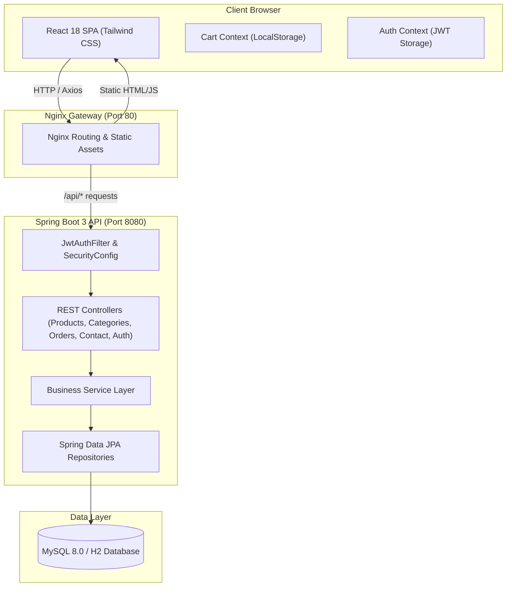

## DEMO - https://palak-misthan-bhandar-9bmx.vercel.app/

# 🍬 Palak Mistan Bhandar — Full-Stack Enterprise Web Application

> **Production-Grade Sweet & Snack Shop Web Application**  
> *Developed for Academic Full-Stack Project Submission & Production Deployment*  
> **Business:** Palak Mistan Bhandar | **Location:** Sanganer, Jaipur, Rajasthan | **Owner:** Shishpal Kumawat

---

## 📋 Table of Contents
1. [Business Overview](#-business-overview)
2. [Tech Stack](#-tech-stack)
3. [Architecture & System Design](#-architecture--system-design)
4. [Key Features](#-key-features)
5. [Database Schema & Seed Data](#-database-schema--seed-data)
6. [REST API Documentation](#-rest-api-documentation)
7. [Getting Started (Local Development)](#-getting-started-local-development)
8. [Docker & Containerized Deployment](#-docker--containerized-deployment)
9. [Production Deployment Guide](#-production-deployment-guide)
10. [Git Setup & Repository Upload](#-git-setup--repository-upload)
11. [Project Submission Checklist](#-project-submission-checklist)

---

## 🏪 Business Overview
**Palak Mistan Bhandar** is a traditional sweet and snack shop situated in the heart of **Sanganer, Jaipur, Rajasthan**. Established in 1985 by the Kumawat family and run by **Shishpal Kumawat**, it has been serving authentic Rajasthani delicacies for over 38 years.

The product catalog includes:
- **Traditional Sweets (Mithai):** Motichoor Ladoo, Kaju Katli, Besan Barfi, Gajar Ka Halwa, Gulab Jamun, Rasgulla, Jalebi, Mohanthal.
- **Snacks & Namkeen:** Pyaaz Kachori, Aloo Samosa, Dal Kachori, Rajasthani Bhujia, Mathri, Chakki Namkeen.
- **Fresh Dairy Products:** Fresh Malai Paneer, Pure Mawa / Khoya, Traditional Bilona Desi Cow Ghee.
- **Beverages & Shakes:** Alphonso Mango Shake, Traditional Sweet Lassi, Fresh Squeezed Orange Juice, Chilled Rose Sharbat, Strawberry Shake.

---

## 🛠️ Tech Stack

### Frontend
- **Framework:** React 18 + Vite
- **Routing:** React Router v6
- **Styling:** Tailwind CSS (Custom Rajasthani Saffron & Gold Theme Palette)
- **State Management:** Context API (`CartContext`, `AuthContext`) + LocalStorage persistence
- **HTTP Client:** Axios with dynamic JWT interceptors and auto-token refresh
- **Icons & UI:** React Icons (`fa`, `gi`), React Hot Toast, CountUp

### Backend
- **Framework:** Spring Boot 3.2.5 (Java 17 / 21)
- **ORM & Data Access:** Spring Data JPA / Hibernate
- **Database:** H2 In-Memory (Zero-config Dev) & MySQL 8.0 (Production profile)
- **Security:** Spring Security 6 with Stateless JWT Authentication (`jjwt 0.12.5`)
- **Validation:** Jakarta Validation (`@Valid`, `@NotBlank`, `@NotNull`, etc.)
- **Error Handling:** Centralized `@RestControllerAdvice` Global Exception Handler
- **Data Seeding:** Automated `CommandLineRunner` initializing products, categories & admin user

### DevOps & Deployment
- **Containerization:** Multi-stage Dockerfiles for both Backend & Frontend
- **Reverse Proxy:** Nginx for SPA routing and API reverse-proxying
- **Orchestration:** Docker Compose (`mysqldb` + `backend` + `frontend`)

---

## 🏛️ Architecture & System Design



---

## 🌟 Key Features

### 🛒 Customer-Facing Portal
- **Hero & Storytelling:** Engaging hero section highlighting shop heritage, stats counter, and Sanganer roots.
- **Categorized Product Catalog:** Browse sweets, snacks, dairy, and beverages with live category filtering and search.
- **Interactive Product Detail:** Quantity selectors, dynamic price tallying, stock status badges, and nutritional highlights.
- **Shopping Cart System:** Persistent client cart, quantity updates, removal, and live order subtotal calculation.
- **Cash on Delivery Checkout:** Clean delivery information form with validation and instant order generation.
- **Order Tracking & Confirmation:** Dedicated receipt page displaying order numbers (`PMB-TIMESTAMP-XXX`) and customer summary.
- **About Us & Heritage Timeline:** Interactive 1985-to-present timeline, owner highlight (Shishpal Kumawat), and shop values.
- **Interactive Gallery:** Filterable media gallery with lightbox modal viewer.
- **Contact & WhatsApp Inquiry:** Direct messaging form, embedded Google Map, and instant WhatsApp chat initiation.

### 🔐 Admin Management Portal (`/admin`)
- **Secure JWT Authentication:** Token-based authentication with role verification (`ROLE_ADMIN`).
- **Dashboard Overview:** Live metric cards showing Total Products, Categories, Orders, Unread Messages, and Cumulative Revenue.
- **Product Management (CRUD):** Add, edit, delete, toggle availability, update stock units, and toggle featured status.
- **Category Management (CRUD):** Organize categories, adjust display orders, upload imagery, and toggle visibility.
- **Order Fulfillment Center:** Filter orders by status (`PENDING`, `CONFIRMED`, `PREPARING`, `READY`, `DELIVERED`, `CANCELLED`), inspect customer addresses and order line items.
- **Customer Inquiry Inbox:** Review messages submitted from the contact form, mark as read, and initiate direct email/WhatsApp replies.

---

## 🗄️ Database Schema & Seed Data

### Entities
1. `AppUser`: `id`, `username`, `password` (BCrypt), `role`, `fullName`
2. `Category`: `id`, `name`, `description`, `imageUrl`, `displayOrder`, `active`
3. `Product`: `id`, `name`, `description`, `price`, `imageUrl`, `available`, `featured`, `unit`, `stock`, `category_id`
4. `Order`: `id`, `orderNumber`, `customerName`, `customerEmail`, `customerPhone`, `deliveryAddress`, `totalAmount`, `status`, `notes`, `createdAt`, `updatedAt`
5. `OrderItem`: `id`, `order_id`, `product_id`, `quantity`, `unitPrice`, `subtotal`
6. `ContactMessage`: `id`, `name`, `email`, `phone`, `subject`, `message`, `read`, `createdAt`

### Default Admin Credentials
- **Username:** `admin`
- **Password:** `admin123`
*(Auto-seeded on first startup by `DataSeeder.java`)*

---

## 📡 REST API Documentation

### 1. Authentication
| Method | Endpoint | Description | Auth Required |
|---|---|---|---|
| `POST` | `/api/auth/login` | Login with username & password, returns JWT | No |
| `GET` | `/api/auth/me` | Fetch authenticated user profile | Yes (Bearer) |

### 2. Products
| Method | Endpoint | Description | Auth Required |
|---|---|---|---|
| `GET` | `/api/products` | Get products (optional `?categoryId=&search=&all=`) | No |
| `GET` | `/api/products/featured` | Get featured homepage products | No |
| `GET` | `/api/products/{id}` | Get product details by ID | No |
| `POST` | `/api/products` | Create a new product | Yes (Admin) |
| `PUT` | `/api/products/{id}` | Update product details | Yes (Admin) |
| `DELETE` | `/api/products/{id}` | Remove a product | Yes (Admin) |

### 3. Categories
| Method | Endpoint | Description | Auth Required |
|---|---|---|---|
| `GET` | `/api/categories` | Get all active categories | No |
| `GET` | `/api/categories/{id}` | Get category by ID | No |
| `POST` | `/api/categories` | Create category | Yes (Admin) |
| `PUT` | `/api/categories/{id}` | Update category | Yes (Admin) |
| `DELETE` | `/api/categories/{id}` | Delete category | Yes (Admin) |

### 4. Orders
| Method | Endpoint | Description | Auth Required |
|---|---|---|---|
| `POST` | `/api/orders` | Place a customer order | No |
| `GET` | `/api/orders` | View all customer orders | Yes (Admin) |
| `GET` | `/api/orders/{id}` | Get order by ID | Yes (Admin) |
| `GET` | `/api/orders/number/{orderNumber}` | Get order by order number | No |
| `PUT` | `/api/orders/{id}/status` | Update order status | Yes (Admin) |

### 5. Contact Inquiries
| Method | Endpoint | Description | Auth Required |
|---|---|---|---|
| `POST` | `/api/contact` | Submit contact inquiry | No |
| `GET` | `/api/contact` | View all messages | Yes (Admin) |
| `PUT` | `/api/contact/{id}/read` | Mark message as read | Yes (Admin) |

---

## 💻 Getting Started (Local Development)

### Prerequisites
- **JDK 17+** (OpenJDK or Eclipse Temurin)
- **Apache Maven 3.8+**
- **Node.js 18+** & **npm 9+**

### Step 1: Start Backend (Spring Boot)
```bash
cd backend
mvn clean spring-boot:run
```
*The backend starts at `http://localhost:8080` with H2 in-memory DB and pre-seeded catalog data.*
*H2 Web Console is accessible at `http://localhost:8080/h2-console` (JDBC URL: `jdbc:h2:mem:palakdb`, User: `sa`, Password: blank).*

### Step 2: Start Frontend (React + Vite)
```bash
cd frontend
npm install
npm run dev
```
*The frontend opens at `http://localhost:5173` and proxies API requests seamlessly to `http://localhost:8080`.*

---

## 🐳 Docker & Containerized Deployment

Run the entire full-stack application (MySQL database + Spring Boot API + React Nginx web server) with a single command:

```bash
# From the project root:
docker-compose up --build -d
```

- **Frontend Application:** `http://localhost` (or `http://localhost:3000`)
- **Backend REST API:** `http://localhost:8080/api/products`
- **MySQL Database:** `localhost:3306`

To shut down:
```bash
docker-compose down
```

---

## 🚀 Production Deployment Guide

### Option 1: Render / Railway (Recommended for cloud hosting)
1. **Backend:**
   - Deploy `backend/` as a Spring Boot / Docker web service.
   - Configure Environment Variables:
     - `SPRING_DATASOURCE_URL`: Connection string of PostgreSQL or MySQL.
     - `JWT_SECRET`: 256-bit secret string.
2. **Frontend:**
   - Deploy `frontend/` as a static web site or Docker service.
   - Set build command: `npm install && npm run build` and publish directory `dist`.
   - Configure proxy rewrite from `/api/*` to the backend URL.

### Option 2: Linux VPS (Ubuntu / Debian / AWS EC2 / DigitalOcean)
```bash
# Clone repository
git clone <your-repo-url>
cd fullstack_project

# Launch containers
docker compose up --build -d
```

---

## 📦 Git Setup & Repository Upload

To initialize and push this project to your GitHub/GitLab account:

```bash
# 1. Initialize Git in the project root
git init

# 2. Add all files
git add .

# 3. Create initial commit
git commit -m "feat: complete production-level fullstack project for Palak Mistan Bhandar"

# 4. Set default branch to main
git branch -M main

# 5. Link your remote GitHub repository
git remote add origin https://github.com/<your-username>/palak-mistan-bhandar.git

# 6. Push to GitHub
git push -u origin main
```

---

## ✅ Project Submission Checklist

- [x] **Full-Stack Architecture:** React 18 SPA + Spring Boot 3 REST API + JPA + SQL Data Persistence.
- [x] **Local Vendor Context:** Custom tailored for *Palak Mistan Bhandar*, Sanganer, Jaipur (Owner: Shishpal Kumawat).
- [x] **Authentication & Authorization:** Secure Spring Security + JWT authentication for admin routes.
- [x] **Data Seeding:** Automatic seeding of 20+ authentic sweets, snacks, dairy, and beverage products.
- [x] **State Management:** Reactive Cart & Auth contexts with LocalStorage persistence.
- [x] **Responsive Mobile UI:** Clean mobile-first design styled with Tailwind CSS.
- [x] **Docker Containerization:** Complete multi-stage Dockerfiles and `docker-compose.yml`.
- [x] **Clean Repository:** `.gitignore` configured to prevent committing `node_modules`, `target`, and environment artifacts.
